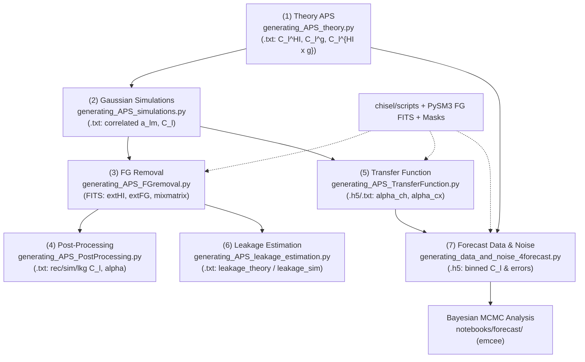

# LSSxHI-CODES

End-to-end Python pipeline for simulating, cleaning, debiasing, and forecasting angular cross-power spectra between **21 cm neutral hydrogen (HI) intensity mapping (IM)** and **large-scale structure (LSS)** tracers (narrow-band optical galaxy clustering, galaxy weak lensing / shear, and CMB weak lensing).

This codebase accompanies the studies:
- **Marins, A., Feng, C., & Abdalla, F. B. (2025)**, *ApJS*, 278, 32 ([doi:10.3847/1538-4365/adc8a4](https://doi.org/10.3847/1538-4365/adc8a4))
- **Marins, A., Feng, C., & Abdalla, F. B. (2026)**, *Unveiling dark energy properties with high-sensitivity cross-correlations of neutral hydrogen intensity mapping and galaxy surveys* ([arXiv:2607.17141](https://arxiv.org/abs/2607.17141))

---

## Pipeline Overview

The codebase is organized into **seven executable Python modes** inside `scripts/`, each paired with a `.ini` configuration file whose parameters can be overridden via command-line arguments. Blind foreground removal (e.g., FastICA, GMCA) and robust transfer-function estimators (e.g., Huber) are powered by the companion **`chisel`** repository (`chisel/scripts/`).

After generating theoretical spectra (Mode 1) and correlated Gaussian realizations (Mode 2), the pipeline splits into two complementary branches:
1. **Map-Level & Leakage Diagnostics Branch (`1 → 2 → 3 → 4 & 6`)**: Saves per-realization foreground-removed FITS cubes, decomposes all HI/foreground/leakage auto- and cross-spectra, and propagates the ICA filter matrix $W_{\mathrm{FG}}$ analytically.
2. **Transfer Function & MCMC Forecast Branch (`1 → 2 → 5 → 7 → MCMC`)**: Computes robust HDF5 transfer functions on the fly, applies amplitude debiasing, adds analytical cosmic variance + thermal/shot noise, bins multipoles with NaMaster, and outputs HDF5 data products for Bayesian MCMC inference (`emcee`).



---

## Repository Structure

```text
LSSxHI-CODES/
├── scripts/
│   ├── generating_APS_theory.py / .ini              # Mode 1: Theoretical Limber C_l via CAMB
│   ├── generating_APS_simulations.py / .ini         # Mode 2: Correlated Gaussian a_lm / C_l mocks
│   ├── generating_APS_FGremoval.py / .ini           # Mode 3: Map synthesis + CHISEL FG removal (FITS)
│   ├── generating_APS_PostProcessing.py / .ini      # Mode 4: Auto/cross/leakage C_l & suppression ratios
│   ├── generating_APS_TransferFunction.py / .ini    # Mode 5: Robust transfer function estimation (HDF5)
│   ├── generating_APS_leakage_estimation.py / .ini  # Mode 6: Analytical W_FG cross-leakage propagation
│   ├── generating_data_and_noise_4forecast.py / .ini# Mode 7: Debiased, NaMaster-binned HDF5 for MCMC
│   ├── cross_functions_theory.py                    # Limber integrators, LSS kernels, YAML loader
│   ├── cross_functions_theory_4forecast.py          # Vectorized kernels, noise & cosmic variance
│   ├── cross_functions_simulations.py               # Cholesky correlated field generator & fast loader
│   ├── handling_data.py                             # Frequency/z grids, FITS I/O, CLI utilities
│   ├── noise_functions.py                           # Gaussian beam b_l & white noise utilities
│   └── parameters/
│       └── lsst_desc_parameters.yaml                # LSST DESC Y1/Y10 survey parameters
├── run/                                             # Bash batch-runner scripts (run_*.sh)
├── notebooks/
│   └── forecast/                                    # emcee MCMC notebooks (w0-wa inference)
├── forecast/                                        # Forecast inputs/outputs
└── screen_outputs/                                  # Logs from batch runs
```

**External sibling directories expected by the `.ini` files:**
- `LSSxHI-DATA/` — stores generated `theoretical/`, `simulations/`, `FGremoval/`, `postprocessed/`, `tfunction/`, `leakage/`, and `data/` outputs.
- `chisel/scripts/` — blind component-separation library (`Extension4BINGO.py`, `load_standard_params.py`, `statcosmo.py`).
- Pre-computed Galactic radio foreground FITS cubes (PySM3 synchrotron + free-free) and optional HEALPix sky masks.

---

## Requirements & Setup

### Python Dependencies
- **Cosmology & Spherical Harmonics**: `camb`, `healpy`, `pymaster` (NaMaster)
- **Scientific Python & I/O**: `numpy`, `scipy`, `pandas`, `h5py`, `astropy`, `pyyaml`
- **Component Separation & MCMC**: `scikit-learn` (FastICA), `emcee`, `matplotlib`

A reference Conda environment file is included at `notebooks/conda_environment.yml`.

### Configuring Paths
Before running on a new machine, check:
1. The `PATH` variable near the top of each script in `scripts/` (points to the directory containing the `.ini` files).
2. Input/output paths inside each `.ini` file (`dirpath_chisel`, `dirpath_foregrounds`, `dirpath_mask`, `pathout`, `dirpath_sims`, `dirpath_tf`, etc.).

---

## Pipeline Modes

Every script loads defaults from its matching `.ini` file and accepts `--<parameter> <value>` overrides via `argparse`.

### 1. Theoretical Angular Power Spectra (`generating_APS_theory.py`)
Computes Limber-approximated $C_\ell$ spectra using **CAMB** (Halofit `takahashi`, configurable dark energy `fluid` or `ppf` for $w_0$--$w_a$):
- Diagonal HI auto-power spectra per frequency channel (assuming no HI inter-channel correlations, top-hat window).
- Auto-power spectrum for a single LSS tomographic bin (`count`/`density`, `shear`/`lensing`, or `cmbwl`).
- HI-channel $\times$ LSS-bin cross-power spectra.

| Key `.ini` Section | Main Parameters |
| :--- | :--- |
| `[Cosmology]` | `H0`, `ombh2`, `omch2`, `ns`, `As`, `mnu`, `w0`, `wa`, `DE_model` (`ppf` / `fluid`) |
| `[CAMB]` | `zmin/zmax/zsteps_integration_camb`, `kmax`, `Pk_nonlinear`, `halofit_version` |
| `[APS]` | `field_1` (`hi`), `field_2` (`count`/`shear`/`cmbwl`), `l_min`, `l_max`, `generate_cl_*`, `pathout`, `prefix`, `suffix` |
| `[COUNT]` / `[SHEAR]` | `path_to_*_params_file`, `survey_*`, `dataset_*`, `bias_model`, `bin_to_use_*`, `nbins_*`, `sigmaz_*` |
| `[HI]` / `[21cm]` | `freq_min`, `freq_max`, `nchannels`, `omegaHI_model`, `biasHI_model` |

**Outputs:** `<prefix>_HI_cl_<suffix>.txt`, `<prefix>_<FIELD2>_cl_<suffix>.txt`, `<prefix>_HIx<FIELD2>_cl_<suffix>.txt`.

```bash
cd scripts
python3 generating_APS_theory.py \
  --H0 67.5 --DE_model ppf --field_1 hi --field_2 density \
  --survey_count LSST --dataset_count Y10 --nbins_count 40 --sigmaz_count 0.001 \
  --bin_to_use_count 1 --prefix "LSST_bin{b}_40_0001" --suffix LOWZ \
  --freq_min 980 --freq_max 1260 --nchannels 30 --verbose True
```

---

### 2. Correlated Gaussian Simulations (`generating_APS_simulations.py`)
Uses the theoretical `.txt` spectra from Mode 1 to generate `nrealizations` correlated Gaussian harmonic realizations ($a_{\ell m}^{\mathrm{HI}}(\nu_i)$, $a_{\ell m}^{g}$) for a given galaxy bin via Cholesky decomposition of the multipole covariance matrix.

| Key `.ini` Section | Main Parameters |
| :--- | :--- |
| `[General]` | `verbose`, `project` |
| `[PATH]` | `filepath_field1`, `filepath_field2`, `filepath_cross`, `pathout` |
| `[Simulations]` | `nrealizations`, `seed0`, `channel_tax`, `limited_correlated_channels`, `channel_min_corr`, `channel_max_corr`, `amplification` |

**Outputs:** Per-realization folders `<pathout>/<project>/sim<i>/` containing `cl_{hi,kappa,cross}_sim.txt` and `alm_{hi,kappa}_sim_{complex,real,imag}.txt`. *(Field 2 retains the legacy label `kappa` for CMB lensing, galaxy shear, and galaxy density.)*

```bash
python3 generating_APS_simulations.py \
  --project "LSSTxLOWZ_40_0001/bin1" \
  --filepath_field1 "../LSSxHI-DATA/theoretical/GCxHI/LSST_bin1_40_0001_HI_cl_LOWZ.txt" \
  --filepath_field2 "../LSSxHI-DATA/theoretical/GCxHI/LSST_bin1_40_0001_DENSITY_cl_LOWZ.txt" \
  --filepath_cross  "../LSSxHI-DATA/theoretical/GCxHI/LSST_bin1_40_0001_HIxDENSITY_cl_LOWZ.txt" \
  --nrealizations 2000 --seed0 9000 --verbose True
```

---

### 3. Map Synthesis & Blind Foreground Removal (`generating_APS_FGremoval.py`)
Converts simulated `alm_hi_sim` from Mode 2 to HEALPix maps (`hp.alm2map`), adds pre-computed diffuse Galactic foreground FITS maps (`Mfg`), optionally applies a sky mask, and runs blind component separation (e.g., FastICA with `ns=4`) using `chisel/scripts/Extension4BINGO.py` and `load_standard_params.py`.

| Key `.ini` Section | Main Parameters |
| :--- | :--- |
| `[Simulations]` | `nrealizations`, `lmax`, `apply_mask` |
| `[Algorithm]` | `method` (`ICA`, `GMCA`), `wtransform` (`identity`), `ns` (`4`) |
| `[PATH]` | `dirpath_chisel`, `dirpath_sims`, `dirpath_foregrounds`, `filename_foregrounds`, `dirpath_mask`, `filename_mask` |
| `[FITS]` | `dirpath_savedata`, `filename_newdir`, `nside`, `numin`, `numax`, `nbands`, `unit`, `stokes` |

**Outputs:** FITS files (`HDU=1`) under `<dirpath_savedata>/<project>/<fullsky|masked>/ns<ns>/sim<i>/` with prefixes `extHI_*`, `extFG_*`, and `mixmatrix_*`.

---

### 4. Diagnostic Post-Processing (`generating_APS_PostProcessing.py`)
Combines Mode 1 theory, Mode 2 simulations, input foreground maps, and Mode 3 FITS outputs to compute per-realization and ensemble-averaged angular power spectra across signal, foreground, reconstructed, and leakage components, along with mean suppression ratios (`alpha_field1`, `alpha_fg`, `alpha_cx`).

| Key `.ini` Section | Main Parameters |
| :--- | :--- |
| `[dataset]` | `nrealizations`, `lmax`, `mask_used`, `ns`, `hdu` |
| `[PATH]` | `filepath_field1/2/cross`, `dirpath_sims`, `dirpath_estimated`, `dirpath_foregrounds`, `filename_foregrounds`, `dirpath_output` |
| `[theory]` / `[simulated]` / `[estimated]` / `[leakage]` / `[cross]` | Boolean flags selecting which spectra (`cl_field1_*`, `cl_fg_*`, `filter_fg`, `cl_cx_*`, `alpha_*`) to compute and save |

**Outputs:** Subdirectories `theory/`, `simulations/`, `estimated/`, `leakage/`, `cross/`, and `alpha/` inside `<dirpath_output>/ns<ns>/`.

---

### 5. Transfer Function Estimation (`generating_APS_TransferFunction.py`)
Computes multiplicative transfer functions $\mathcal{T}_\ell(\nu)$ (stored as `alpha`) used to debias foreground-removed HI auto- and HI$\times$galaxy cross-power spectra. Runs **independently of Modes 3 and 4**, executing `chisel` cleaning on the fly across `nrealizations` from Mode 2 (with an `optimized = True` low-RAM streaming option) and supporting robust aggregation via `chisel/scripts/statcosmo.py` (`mean`, `median`, `huber`, `biweight`).

| Key `.ini` Section | Main Parameters |
| :--- | :--- |
| `[General]` | `verbose`, `project` (supports `{b}`), `threshold`, `optimized` |
| `[Simulations]` | `nrealizations`, `nside`, `lmin`, `lmax`, `apply_mask`, `include_wn`, `include_beam`, `wn_sigma_pix`, `beam_fwhm`, `numin`, `numax`, `nbands` |
| `[TransferFunction]` | `tf_hixhi`, `tf_gxhi`, `cross_g_bin`, `auto_hi_bins`, `cross_hi_bins`, `estimator` (`huber`), `save_simulated`, `save_theoretical`, `save_hdf5`, `save_txt` |
| `[Algorithm]` | `method`, `wtransform`, `ns` |
| `[Inputs]` / `[Outputs]` | `dirpath_chisel`, `dirpath_sims`, `dirpath_foregrounds`, `filename_foregrounds`, `filepath_field1/2/cross`, `pathout` |

**Outputs:** HDF5 files (e.g., `alpha_cx_sim_noiseless_smoothless.h5`, `alpha_ch_sim_noiseless_smoothless.h5`) containing `alpha`, `variance_alpha`, `alpha_matrix`, `mixmatrix`, `Wfg`, `hi_bins`, and `g_bin`.

```bash
for b in $(seq 0 7); do
  python3 generating_APS_TransferFunction.py \
    --cross_g_bin $b --nrealizations 500 --estimator huber --optimized True --verbose True
done
```

---

### 6. Analytical Leakage Estimation (`generating_APS_leakage_estimation.py`)
Constructs the linear foreground-removal projection matrix $W_{\mathrm{FG}} = \hat{A}(\hat{A}^{\mathsf{T}}\hat{A})^{-1}\hat{A}^{\mathsf{T}}$ from realization 0 of Mode 3 (`mixmatrix`) and propagates it onto both the theoretical cross-power spectrum (over `nu_min_correlated`..`nu_max_correlated`) and the mean simulated cross-power spectrum from Mode 2.

**Outputs:** `leakage_theory.txt` and `leakage_sim.txt` in `<dirpath_output>/ns<ns>/`.

---

### 7. Forecast Data & Noise Generation (`generating_data_and_noise_4forecast.py`)
Generates the final $\ell$-binned HDF5 spectra and error bars used in the MCMC cosmological parameter inference (`notebooks/forecast/`). Reads **Mode 1 theory** and **Mode 5 HDF5 transfer functions** directly (independent of Modes 2–4), internally synthesizes 1 correlated realization, runs `chisel` FastICA cleaning, applies transfer-function debiasing (`apply_tf = True`), computes cosmic variance + HI thermal white noise + galaxy Poisson shot noise, and applies NaMaster linear $\ell$-binning ($\Delta\ell = 4$, $30 \le \ell \le 400$).

| Key `.ini` Section | Main Parameters |
| :--- | :--- |
| `[Simulations]` | `lmin` (`30`), `lmax` (`400`), `apply_mask`, `apply_tf`, `namaster_delell` (`4`), `ell_nmt_{hi,g,gxhi}`, `nside`, `seed_hi`, `seed_k`, `seed_tax` |
| `[HI]` | `numin` (`980`), `numax` (`1260`), `nbands` (`30`), `fwhm_arcmin` (`40`), `sigma_pix` (`0.154`) |
| `[Galaxy]` | `survey_name` (`LSST`), `data_release` (`Y10`), `type_of_field` (`density`), `path_to_file`, `ntomos` (`40`), `sigmaz` (`0.001`) |
| `[Algorithm]` | `method` (`ICA`), `wtransform` (`identity`), `ns` (`4`) |
| `[Outputs]` | `auto_hi_bins`, `cross_hi_bins`, `auto_g_bin`, `cross_g_bin`, `dirpath_tf`, `filename_tf_{hi,gxhi}`, `pathout`, `save_{hi,g,gxhi}`, `save_{theory,simulated,estimated}`, `save_hdf5` |

**Outputs:** HDF5 files per channel pair (e.g., `cl_gcLSSTxLOWZ_<b>x<c>_40_0001_delell4_{theory,simulated,estimated}.h5`) containing `l`, `cl`, `errcl` (plus `cl_uncorrected` and `errcl_uncorrected` in `_estimated.h5`).

```bash
for b in $(seq 1 7); do
  python3 generating_data_and_noise_4forecast.py \
    --auto_g_bin $b --cross_g_bin $b --verbose True
done
```

---

## Quick-Start Workflows

### A. Dynamical Dark Energy ($w_0$--$w_a$) Forecast Pipeline
Reproduces the LOW-Z HI IM ($980$–$1260\;\mathrm{MHz}$, 30 channels) $\times$ LSST-like Y10 (40 bins, $\sigma_z^0=0.001$) forecast workflow:
1. Run `generating_APS_theory.py` for overlapping galaxy bins `b = 0..7`.
2. Run `generating_APS_simulations.py` (`nrealizations = 500` or `2000`) for each bin `b`.
3. Run `generating_APS_TransferFunction.py` (`--estimator huber --optimized True`) for each bin `b`.
4. Run `generating_data_and_noise_4forecast.py` for bins `b = 1..7` (Sets 1–7).
5. Run the `emcee` MCMC notebooks in `notebooks/forecast/` (e.g., `COVmodel3_ALLbins__5k--estimated.ipynb`).

### B. Full Map-Level FG Removal & Leakage Diagnostics
1. Run Modes 1 and 2 (or `run/run_theory_*.sh` and `run/run_simulations_*.sh`).
2. Run `generating_APS_FGremoval.py` (or `run/run_FGremoval_density_LSST_LOWZ.sh`).
3. Run `generating_APS_PostProcessing.py` (or `run/run_postprocessing_density_LSST_LOWZ.sh`).
4. Run `generating_APS_leakage_estimation.py`.

---

## Notes & Known Caveats

- **Boolean CLI Arguments**: Modes 2 and 5 parse boolean CLI flags with `hdata.str2bool`. Modes 1, 3, 4, 6, and 7 cast CLI strings with `bool(...)`, so boolean flags set to `False` should be edited directly in the `.ini` file.
- **Transfer Function Sky Setup**: In the current snapshot of `generating_APS_TransferFunction.py`, verify the sky-composition line (`Xsky = Xfg + 0*Xhi` used in `_noHIsky` tests) before running full production transfer-function batches.
- **Minor Code Items to Watch**:
  - `generating_APS_PostProcessing.py` (lines 360, 363): check complex reconstruction of `alm_hi_sim` (`alm_hi_sim_real` vs `alm_hi_sim_imag`).
  - `generating_APS_TransferFunction.py` (line 168): set `dirpath_mask` in the `.ini` file due to a typo in the CLI argument name.
  - `generating_data_and_noise_4forecast.py` (line 1058): `clcx_est_uncorrected` checks `ell_hi` rather than `ell_gxhi` (equivalent when both are `True`).

---

## Citation

If you use this codebase in your research, please cite:

```bibtex
@article{Marins2025,
  author  = {Marins, Alessandro and Feng, Chang and Abdalla, Filipe B.},
  title   = {Cross-correlations of neutral hydrogen intensity mapping and weak lensing},
  journal = {The Astrophysical Journal Supplement Series},
  volume  = {278},
  pages   = {32},
  year    = {2025},
  doi     = {10.3847/1538-4365/adc8a4}
}

@article{Marins2026,
  author        = {Marins, Alessandro and Feng, Chang and Abdalla, Filipe B.},
  title         = {Unveiling dark energy properties with high-sensitivity cross-correlations of neutral hydrogen intensity mapping and galaxy surveys},
  year          = {2026},
  eprint        = {2607.17141},
  archivePrefix = {arXiv},
  primaryClass  = {astro-ph.CO}
}
```
